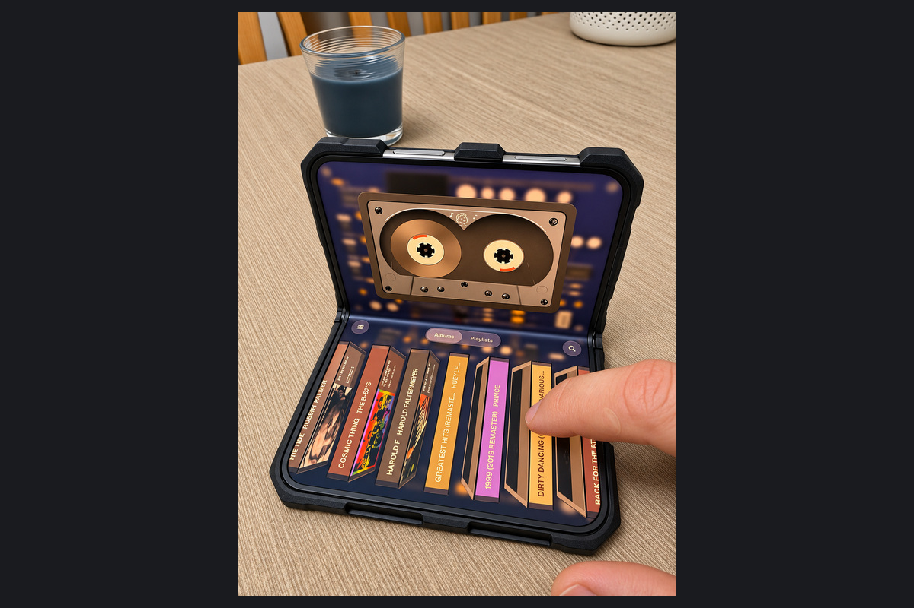

I miss the willingness of early iPhone apps to be a little ridiculous in a good way. The beer apps that turned the screen into a glass understood that the phone itself could be part of the fun. An app did not always have to justify its existence with another productivity promise.

Cassette Player brings some of that feeling to the iPhone Duo. Jerry Munyoka Nkongolo's Rafikki Studio has made a digital tape deck with a clear physical identity, then given that identity room to change with the phone. The folding layout is part of what makes the idea appealing.

There is a practical reason to care, too. Music software is very good at making a collection available. I also like an interface that encourages me to choose an album and stay with it. A tape with a visible player gives that listening session a sense of place.


I received a review code. This review focuses on the iPhone Duo design, with my own device photos and researched feature, pricing, and privacy details. Playback reliability has not been independently verified. This is Rafikki Studio's music player.


## My take

Cassette is one of the clearest examples of why I am enjoying this direction for Duo apps. It takes the physical character of the device seriously. There is a compact player when space is limited and room for the tape, circuitry, and library when the phone opens up. That is a much more interesting use of the hardware than making the same controls larger.

The main reservation is how young the app is. Its first updates address core playback behavior. That deserves acknowledgment in a review because the player has to work before its presentation can add anything. I would try the free listening experience through several complete albums before paying for customization.

## The design is the reason to look

The [App Store description](https://apps.apple.com/us/app/cassette-player/id6819145485) lists Apple Music and local-file playback, animated tapes, physical-style controls, and tape customization using drawings or photos. The developer's artwork shows the iPad player as a visible speaker and circuit board. This is software presenting itself as an object, with the mechanical details made part of the attraction.

I like that there is an identifiable design idea behind it. A transparent housing, a label, or a drawing can make the player feel like something chosen. That matters in a category where the music itself may be available through several interfaces.

There is a practical tradeoff, though. A physical metaphor can introduce ceremony where someone else wants one immediate action. The right balance depends on the listener. If I am sitting down with an album, the interaction may be part of the enjoyment. If I am trying to find one song quickly, the route through the library matters more than a convincing cassette shell.

## The Duo becomes the player

The [1.0.2 release notes](https://apps.apple.com/us/app/cassette-player/id6819145485) describe a compact cover-screen layout, an open-flat circuit-board view, an upright arrangement with the library beneath the cassette, and a half-open book layout with the two beside each other.

I like the logic of those choices. The closed phone is something portable to operate quickly. Opening it gives the player a stage. The book layout lets the collection and the currently playing object occupy different parts of the screen, so browsing does not have to displace the thing I am listening to.

That relationship between movement and software is what recalls the playful early iPhone era for me. The device changes shape and the interface makes sense of it. The interaction belongs to this particular phone.

The important restraint is keeping the music controls readable. If the tape and circuitry become so elaborate that finding a track feels like work, the metaphor has gone too far. That is the balance I want from a playful player: enough character to enjoy, with the ordinary listening actions still easy to reach.

Version 1.0.3 adds a [Shelf view on the Duo](https://apps.apple.com/us/app/cassette-player/id6819145485), with tape cases standing in a row to flick through. Library sorting by album, artist, or recent listening and an Apple Music favorites filter provide more direct routes through the collection. I like the combination: a shelf gives browsing character, while sorting helps when I already know what I want.

<figure>
  
  <figcaption>The cassette sits above the album library in this tabletop arrangement. The open and compact player views appear in the header. Photo by Kyle Reddoch; app by Rafikki Studio. <a href="/assets/images/app-reviews-2026-11-05/cassette/tabletop-library-full.jpg">View full photo</a>.</figcaption>
</figure>

I would also resist equating visual detail with audio quality. A beautifully drawn speaker tells me something about the interface. It does not tell me anything about fidelity, supported output formats, or battery use. Those would require separate evidence.

The new fast-forward and rewind effects add another part of the tape-deck illusion. The [1.0.3 update](https://apps.apple.com/us/app/cassette-player/id6819145485) describes music speeding up or running backward over motor and tape sounds. Extra visual styles now download when selected, reducing the initial download. I have not yet listened to those new transport effects myself, but they fit the app's interest in making playback feel physical.

## Playback reliability comes first

The developer's [version history](https://apps.apple.com/us/app/cassette-player/id6819145485) acknowledges an Apple Music playback failure in 1.0 and reports fixes in 1.0.1 and 1.0.2. Those are documented fixes, not failures I personally encountered or fixes I independently verified.

I appreciate an explicit explanation of a problem. It gives me something concrete to check. For a music app, completing an album and moving between tracks are basic expectations. I would also spend time with the screen locked and with ordinary interruptions before describing it as a dependable daily player.

That is the difference between an appealing first look and a recommendation I could make confidently after living with it. The early release history makes patience reasonable without making the app unworthy of trying.

## What the purchase buys

Cassette Player is free to download and includes Apple Music playback and up to 25 local songs. [Cassette Studio](https://apps.apple.com/us/app/cassette-player/id6819145485) costs $12.99 as a one-time purchase, unlocking the full customization options and unlimited local songs. An [Apple Music subscription](https://www.apple.com/apple-music/) is separate. The player requires iOS or iPadOS 26.5.

I like being able to evaluate the central activity before buying the visual extras. Someone happy with the basic player may have little reason to upgrade. Someone who enjoys making the tape their own has a more specific reason to pay. I would make that decision after confirming playback with the music I actually want to hear.

## A quick note on privacy

Cassette's [privacy policy](https://walnut-burst-160.notion.site/Cassette-Player-Privacy-Policy-3f83971e7add81848d21cb66af670b68) says local music and custom tape artwork stay on the device, with no advertising or analytics. Some optional extras ask for camera or microphone access, so I would enable those only when I want the feature.

## Who should consider it

Cassette's appeal is easy to understand if you miss music interfaces with physical character. On the Duo, the tape-deck metaphor gets room to become an experience you can arrange in your hands or set beside you. The paid extras are tied to personalization rather than an additional recurring subscription.

Someone mainly concerned with managing a large collection or minimizing every interaction may find less value in that presentation. For me, the reason to look is precisely that it makes room for enjoyment. The free version provides a sensible way to check playback first, and the design gives the Duo something memorable to do once the music starts.
