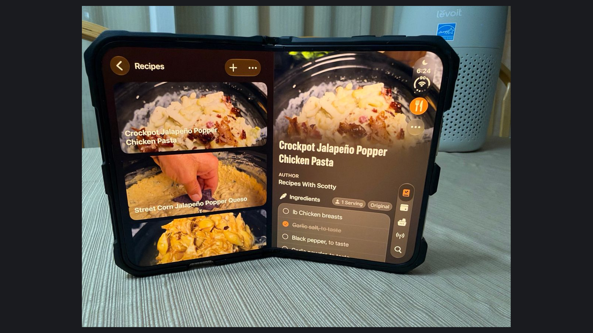
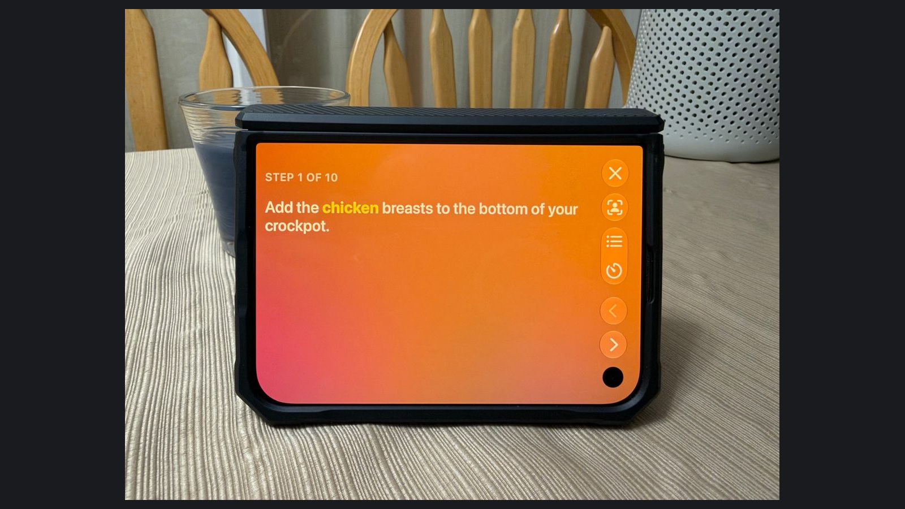

Lume is the kind of app that makes the iPhone Duo's shape feel useful. A recipe needs room for ingredients and instructions, and a phone on a kitchen counter needs to be readable without being held all the time. Those are good reasons for a developer to think beyond a conventional portrait screen.

What I like about João Franco's approach is that the hardware helps explain the interface. The wide layout can act like an open cookbook. Partially folded, the phone can become a small cooking station. There is personality in that idea, but it serves an ordinary task.

That is the thread I enjoy in this new group of iPhone apps. The phone gets to become something: a notebook, a tape deck, or, here, a companion on the kitchen counter. It brings back some of the fun of software that responds to the object in your hands.


I received a review code. This review focuses on the iPhone Duo design, with my own device photos and researched feature, pricing, and privacy details. Import accuracy and cooking reliability have not been independently verified.


## My take

Lume makes a strong design case for the Duo because its layouts respond to what someone is doing. Browsing a cookbook and following a cooking step call for different arrangements. The extra screen area and the fold give those arrangements a physical purpose.

The other strength is continuity. If the recipe I save can become the meal I plan and the list I shop from, there is less repeated work between those steps. That is a useful reason to choose a dedicated app over a collection of bookmarks.

My main reservation is import accuracy. A recipe manager can look orderly while quietly carrying an incorrect quantity or an incomplete instruction. I would put faithful importing and easy correction ahead of the more eye-catching features. This review does not establish Lume's import success rate, but its recent updates make that an especially relevant part of the review.

## Collecting is only the beginning

Lume's [App Store description](https://apps.apple.com/us/app/lume-recipe-manager/id6755165641) lists website imports, folders, tags, favorites, serving adjustments, meal planning, and grocery lists. Serving changes and unit conversions update quantities throughout the recipe, which is useful when cooking for a different number of people or working with unfamiliar measurements. The free version holds ten recipes. That is enough room to evaluate a small, varied collection before paying to bring over a whole cookbook.

I would use that space deliberately. A straightforward recipe page is one case; a long recipe with separate components is another. If a sauce and a main dish both call for an ingredient, I still want to know which amount belongs to which step. The goal is to reduce copying without losing the original author's meaning.

The version 1.0.4 [release notes](https://apps.apple.com/us/app/lume-recipe-manager/id6755165641) describe improved social-media imports using Apple Intelligence, following earlier fixes to sharing and parsing. That is useful evidence of active work. It is also a reason to compare an imported recipe with its source instead of assuming a clean-looking result is complete.

<figure>
  
  <figcaption>The recipe list stays beside the selected recipe in this book-like layout. Photo by Kyle Reddoch; app by João Franco. Recipe by Recipes With Scotty. <a href="/assets/images/app-reviews-2026-11-05/lume/book-layout-full.jpg">View full photo</a>.</figcaption>
</figure>

## The cooking view is the feature I care about most

The [press kit](https://lume.recipes/press-kit) describes Cook Mode, detected timers, Live Activities, and Apple Watch controls. Its Duo compositions show two useful arrangements: a wide recipe view, and a partially folded cooking view with the current instruction above the ingredients and navigation controls.

<figure>
  
  <figcaption>Cook Mode showing the first step of the Recipes With Scotty recipe on my Duo’s compact landscape screen. Photo by Kyle Reddoch; app by João Franco. <a href="/assets/images/app-reviews-2026-11-05/lume/cook-mode-full.jpg">View full photo</a>.</figcaption>
</figure>

The [developer's tabletop demonstration](https://x.com/JoaoFranco_03/status/2116318852548055097) reinforces the Duo detail that makes the most sense to me: the instruction faces the person cooking, while the lower area provides the ingredients and controls. My photo above shows the separate compact landscape view, with one large instruction and the navigation buttons beside it. The screen arrangement follows the task. It gives the fold a reason to exist beyond making more content fit.

That can feel playful without becoming a novelty for its own sake. There is pleasure in opening a phone and seeing it take on a recognizable job. In Lume's case, the useful part is having the next instruction and the quantities close together, rather than trying to remember one while navigating to the other.

The same principle applies to timers. Recognizing a time in the recipe is helpful only if I can tell which timer belongs to which task. A well-designed cooking screen should let me recover after an interruption without rereading everything from the beginning.

Lume also offers optional hands-free navigation using facial gestures. Paired with a phone resting on the counter, that has an obvious appeal when hands are messy. I would still want the ordinary buttons to remain clear. Camera-based controls need to work under the lighting, viewing angle, and movement of a real kitchen; a composition alone cannot settle that.

## Planning and sharing need to survive changes

The [developer's materials](https://lume.recipes/press-kit) describe household sharing, a weekly planner, and groceries grouped by aisle. Those are useful extensions of a recipe collection. They also introduce the questions that matter once more than one person is involved.

Plans move. Someone buys an ingredient on the way home. A recipe gets scaled after the shopping list has already been made. My standard would be whether the app makes those changes understandable without adding cleanup work. I would rather have a clear list that needs a quick edit than an automatically generated list whose quantities I cannot explain.

That is also how I would compare Lume with another recipe manager: use the same recipes and follow them through to the shopping and cooking stages. Comparing feature names alone would miss the part that matters.

## Free access and Lume Pro

Lume is free for up to ten recipes. [Lume Pro](https://apps.apple.com/us/app/lume-recipe-manager/id6755165641) costs $1.99 a month, $11.99 a year, or $19.99 as a one-time purchase. It adds unlimited recipes, household sharing, scanning from the camera, files, or photos, Smart Folders, and the Discovery Feed. Family Sharing covers up to five family members. The app requires iOS or iPadOS 26.

I like having a meaningful small collection available before committing. The one-time price is appealing for someone who expects to keep a cookbook for years. I would still choose on the quality of the core workflow. Paying once does not make inaccurate imports or awkward editing easier to live with.

## A quick note on privacy

Lume keeps recipes and meal plans on the device or in your own iCloud account, according to its [privacy policy](https://lume.recipes/privacy). The optional hands-free face controls are processed on the device too.

## Who I would put it in front of

Lume looks most compelling for someone whose recipes are scattered across websites and saved posts and who wants to use that collection throughout the week. For a Duo owner, the wide cookbook and partially folded cooking view add a particularly good reason to look. They give the phone a role on the counter that feels considered.

For someone already happy with a substantial cookbook elsewhere, I would still establish that imports and corrections work before moving everything. Lume's appeal is the combination of that practical work with an interface that makes the device enjoyable to use. The fun is in seeing the Duo become the right shape for the job.
