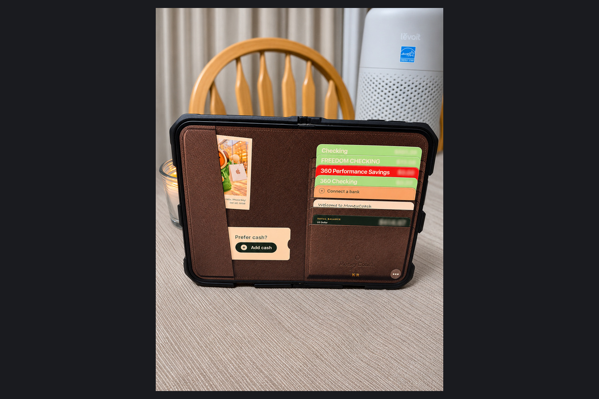

I would not have put a budgeting app at the top of a list of playful iPhone software. MoneyCoach's Duo wallet is a good reason to reconsider that. A phone that folds becomes a wallet that opens, with accounts represented as cards inside. The physical action and the interface belong together.

That is the part of the iPhone Duo I want developers to explore. There was a charm to early iPhone software that made the thing on screen feel like a familiar object. MoneyCoach applies that willingness to play to an app with a serious everyday job.

I like that combination. Money management does not have to look joyless to be useful. It does, however, still need understandable totals, manageable entry, and clear choices about where financial information goes.


I received a review code. This review focuses on the iPhone Duo design, with my own device photos and researched feature, pricing, and privacy details. No financial outcomes, bank-sync reliability, or savings have been measured for this review.


## My take

The Duo wallet gives MoneyCoach an identity I can understand immediately. Opening the device and opening the wallet are the same idea. The full budgeting interface then gives the larger display a more analytical role, with room to see the account and the information behind it.

The tradeoff is complexity. More entry methods, account types, sharing options, and AI connections create more choices about both setup and data handling. I would start with the smallest useful configuration and add features when a specific need appears. A comprehensive app is valuable when it reduces work, not when it gives me more settings to maintain.

## The fold is part of the wallet

MoneyCoach's [version 14 announcement](https://moneycoach.ai/blog/introducing-moneycoach-14) describes a 3D leather wallet that opens with the Duo. Accounts appear as cards; tapping one opens the account or a transaction action, and the banknotes lead to the cash account. The developer says these are the same underlying accounts used by the full app.

That connection gives the visual metaphor substance. The wallet provides a different way to reach actual information. It makes an abstract collection of account rows into something with a recognizable arrangement.

The appeal for me is partly tactile and partly personal. A familiar object can make an app easier to approach, and a wallet is a particularly natural match for a folding phone. It has an outside and an inside. Opening it reveals things. The screen's change in shape helps the idea make sense before I have read a feature list.

<figure>
  
  <figcaption>A larger view of the open wallet shown in the header. The account cards, cash action, and total-balance pocket are visible; the supplied photo already blurs the balances. Photo by Kyle Reddoch; app by MoneyCoach UG. <a href="/assets/images/app-reviews-2026-11-05/moneycoach/open-wallet-full.jpg">View full photo</a>.</figcaption>
</figure>

I would still want a quick route to the ordinary account view. The wallet is enjoyable when it adds an approachable way in, while the detailed tools remain available for the work that needs them.

The [14.0.1 update](https://apps.apple.com/us/app/moneycoach-ai-budget-planner/id989642198) improves that continuity: MoneyCoach remembers whether I last used the wallet or the full interface. Wallet cards also reflect account icons and bank colors, making the presentation more useful for recognizing an account at a glance.

## More room for the numbers behind the cards

The [Duo product page](https://moneycoach.ai/moneycoach-for-iphone-duo) distinguishes the Wallet experience from the full MoneyCoach interface and shows accounts and transactions together in its book layout. That is the other half of good Duo design: giving the extra space to related information.

Seeing a selected account beside its transactions can preserve context. I can keep track of what I am examining as I move through the details. For a budgeting app, that is a stronger use of a wide screen than increasing the size of a single balance.

This is why the wallet works as a reason to look at MoneyCoach, rather than the whole reason to choose it. The playful layer gets my attention. The underlying layouts need to make the financial record easier to understand.

## A budget needs an understandable record behind it

MoneyCoach's [feature guide](https://moneycoach.ai/features) describes category budgets with adjustments, rollover, and transfers, alongside its classic budgets. It also lists Shortcuts, widgets, and Watch features. Those are sensible places to put quick actions and useful numbers, especially if they help someone record a purchase close to when it happens.

What matters to me is the relationship between the summary and the transaction underneath. If a category looks wrong, I want to find the entries that explain it. If I move money between accounts, I want the reports to reflect a transfer accurately. A chart should make the record easier to understand, not ask me to trust a total I cannot trace.

Version 14.0.1 adds [customizable transaction rows](https://apps.apple.com/us/app/moneycoach-ai-budget-planner/id989642198), with choices such as account, description, payee, tags, and location. A preview shows the arrangement before it is saved. That is a useful kind of customization: someone checking payees may need a different view from someone separating spending by account. Reports also join the default iPhone tabs, while existing custom arrangements are retained.

The [App Store listing](https://apps.apple.com/us/app/moneycoach-ai-budget-planner/id989642198) includes CSV imports, reports, multi-currency tools, and exports. Import and export are especially important in this category. Before moving a financial history, I would try a representative sample and check dates, transfers, currencies, and categories. I would also export it again. Getting data back out is part of evaluating the app.

## Bank sync depends on the bank and the region

MoneyCoach's [feature guide](https://moneycoach.ai/features) lists bank connections in the US and Europe, with Canadian support coming soon. I would check the in-app bank selector for my own institution before choosing a plan around automatic imports.

Automatic imports could remove a substantial amount of entry work. They also need ordinary checking. Pending and settled transactions, delayed updates, and category corrections are the practical cases I would inspect in any connected budgeting app. I have not tested MoneyCoach against my own bank for this review.

Manual entry is still a valid choice. It asks more of the person using it, but it avoids making a bank connection a prerequisite for starting. The right choice depends on whether the time saved by importing outweighs the additional connection and review work.

## Pricing: free to download, then a paid plan

[MoneyCoach](https://moneycoach.ai/pricing) is free to download and offers a free trial, followed by a paid subscription. There is no permanent free plan. That distinction matters when comparing it with an app that offers ongoing basic use at no charge.

Premium starts at €4.99 a month or €39.99 a year and includes unlimited accounts and budgets, partner sharing, and up to four bank logins. Premium Max starts at €7.99 a month or €59.99 a year, adding investment tools, up to eight bank logins, and optional AI-assistant connections. Prices vary by country and currency.

I would choose Premium Max only for a feature I could name and expected to use. A higher tier is not automatically a better budgeting system. For partner use, I would also check the [sharing FAQ](https://moneycoach.ai/faqs): sharing financial data and sharing a subscription are separate arrangements, and the individual accounts need the appropriate access.

## A quick note on privacy

For me, the main privacy choice is whether to track finances manually or connect a bank. MoneyCoach's [privacy policy](https://moneycoach.ai/privacy-policy) describes local storage with optional iCloud sync for manual entries. Bank sync involves external services, including AI categorization of transactions. I would be deliberate about connecting accounts and sharing financial information, while starting with only the features I need.

## Where I think it fits

MoneyCoach deserves consideration from Apple users who want a fuller budgeting system and are willing to spend some time setting it up. For Duo owners, the wallet and book layouts give it a more distinctive appeal. The design makes use of both how the phone opens and what becomes possible once it is open.

I would be less quick to recommend it to someone who wants a permanently free expense log or needs a currently unsupported bank. Those needs call for a different evaluation.

The deciding question is whether MoneyCoach makes the record clearer and easier to maintain over time. The wallet cannot answer that by itself. What it does demonstrate is a direction I like: financial software can take its job seriously and still give me a reason to smile when I open my phone.
