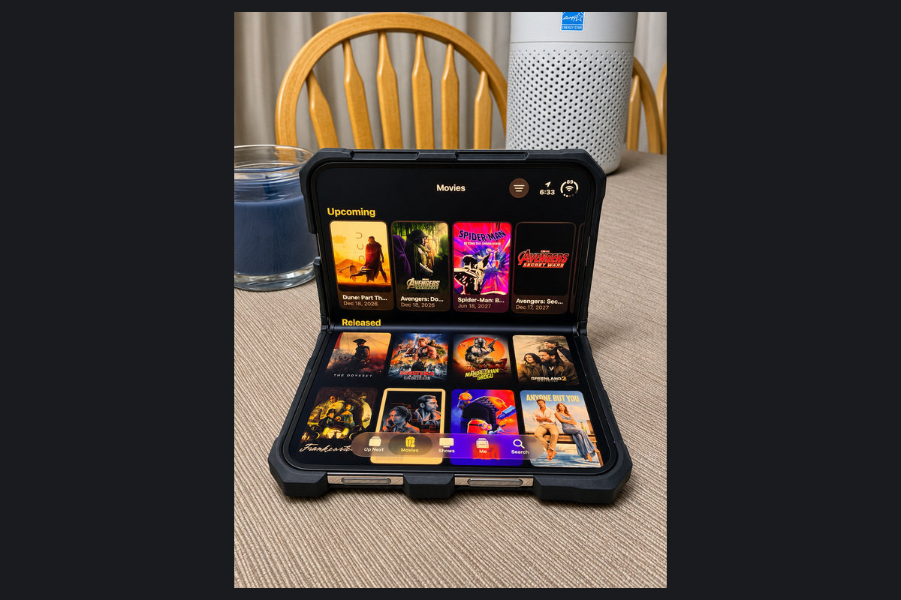

One of the things I like about the iPhone Duo is that developers have a reason to think about what a phone can become in your hands. Open it, close it, prop it beside you, and there is an opportunity to give the software a different role. Showcase makes sense to me in exactly that context: a movie and TV tracker that can become a small companion to movie night.

There is some of that early iPhone spirit here: software that gives me a reason to enjoy the device as well as use it. Showcase has a practical job, and I appreciate the willingness to make the hardware part of the experience.

I also bring some history to this category. When I wrote about [why Trakt is still my home base for movies and TV](/blog/why-trakt-is-still-my-home-base-for-movies-and-tv/), years of watched episodes and ratings were central to the argument. Showcase needs to respect that record while giving me a new reason to enjoy using it.


I received a review code. This review focuses on the iPhone Duo design, with my own device photos and researched feature, pricing, and privacy details. Performance and sync behavior have not been independently verified.


## My take

Showcase's appeal is that keeping track can be part of enjoying movies and television. The visual presentation has somewhere useful to go on the Duo, especially when the phone is sitting beside the couch. It gives the extra screens a role in the activity instead of treating them as spare space.

For someone with an established Trakt account, continuity remains the deciding practical issue. I am interested in Showcase as a more enjoyable daily interface. Before entrusting it with the whole archive, I still want to understand how its connection handles the records I already have.

## A place for the Duo beside the couch

Showcase's [version 1.5.2 release notes](https://apps.apple.com/us/app/showcase-movie-tv-tracker/id1576840648) describe an Up Next presentation on the outer screen when the Duo is in tent or kickstand mode. The queue becomes a sequence of cards that can sit beside you while you catch up.

That is an appealing answer to a real design question: what should the app do when I stop holding the phone like a conventional handset? A nearby display of what comes next suits this job. I can imagine the phone having a place in the evening, rather than being something I pick up, consult, and immediately put away.

It also gives the poster-led presentation a purpose. A watchlist is partly a practical record and partly anticipation. Seeing the next film or episode as a distinct card plays into that second part. The app can feel like a little piece of the entertainment setup.

The test for this kind of design is whether the useful action stays close. An attractive card should still make it clear what I am looking at and how to keep my place. That is where I want the playfulness to lead: an interface I enjoy opening that also makes the next decision easier.

The photos at the top show the Available queue in wide and compact layouts. The wide view fits two columns of cards; the compact view stacks them in one column.

## The watchlist has a job to do

The [developer's site](https://getshowcase.app/) describes movie, season, and episode tracking alongside ratings, release alerts, discovery, and friend activity. It also lists widgets, an Apple Watch app, and the ability to snooze a title. Those features fit together around a sensible task: finding the next thing worth watching and remembering where I stopped.

Streaming availability and filters for the services I actually use make that task more practical. Siri support also offers a quick way to ask what is available tonight. I am more interested in those routes to a decision than in a longer list of titles to browse.

Snoozing is a particularly good idea. Following a show should not mean committing to think about it every week. A useful queue needs a way to acknowledge that I am interested but not ready to catch up. The same applies to alerts. A premiere reminder can help; a constant stream of entertainment notifications can become another reason to silence an app.

I would judge discovery by whether it shortens the decision. More recommendations are not automatically more useful. Recommendations from people whose taste I understand have a clearer purpose than another endless selection to browse.

<figure>
  
  <figcaption>The Movies view on my partially folded Duo. Upcoming and Released sections keep the poster library visible across the screen. Photo by Kyle Reddoch; app by Ryan Gittings / Gittings Studio Ltd. <a href="/assets/images/app-reviews-2026-11-05/showcase/movies-full.jpg">View full photo</a>.</figcaption>
</figure>

## Trakt support is the important part for me

Showcase advertises [Trakt sync and imports from Trakt, Letterboxd, and TV Time](https://getshowcase.app/). That gives existing users a route in. It does not, on its own, establish which fields move in each direction or what happens when two devices disagree.

I would check a small, recognizable part of my history first: an unfinished season, a rewatch, a rating, and a title I removed from my watchlist. Those are different kinds of records. Seeing the right film in a library is only the beginning of confirming that a migration preserved what mattered.

That is a practical reservation, not a finding that Showcase loses data. I have not established that. My preference is simply to keep the existing record until I know how the new app handles it. A tracker becomes much harder to replace after it holds several years of decisions.

## The everyday tracking still has to work

The same [release notes](https://apps.apple.com/us/app/showcase-movie-tv-tracker/id1576840648) describe watched and followed changes that persist offline and synchronize when connectivity returns. Release countdowns now use the same local-midnight timing across the app, widgets, and Watch, and notification links open the relevant title directly. These are modest changes individually, but a tracker feels more dependable when its different surfaces agree. Showcase requires iOS or iPadOS 26.

Offline tracking also belongs in the essentials column. Recording an episode on a flight should be an ordinary action. These release notes identify improvements worth checking; they do not substitute for observing those actions on my own devices.

## Pricing and privacy

Showcase is free to download, with [Showcase Plus](https://apps.apple.com/us/app/showcase-movie-tv-tracker/id1576840648) costing $1.99 a month, $9.99 a year, or $29.99 for lifetime access. [Family Sharing](https://getshowcase.app/press/) is included for up to five family members. I would establish which features I need and where the free limits appear before choosing a plan. A lifetime option is welcome, but it only becomes good value if the app remains useful.

The privacy question I care about most is who can see my watch history. Before using the friend features or connecting another tracking service, I would check what I am sharing. Showcase's [privacy policy](https://getshowcase.app/privacy/) is there for anyone who wants the details.

## Who Showcase makes sense for

Showcase belongs on the shortlist for someone who wants movies and TV together, cares about upcoming releases, and enjoys a library with some personality. On the Duo, that personality has a physical context: the phone can sit beside the couch and become part of the experience.

For an established Trakt user like me, the deciding factor is how comfortably it fits around the history already there. If that connection holds up, Showcase offers something I want more of in iPhone software: a useful tool with enough character that opening it is part of the pleasure.
