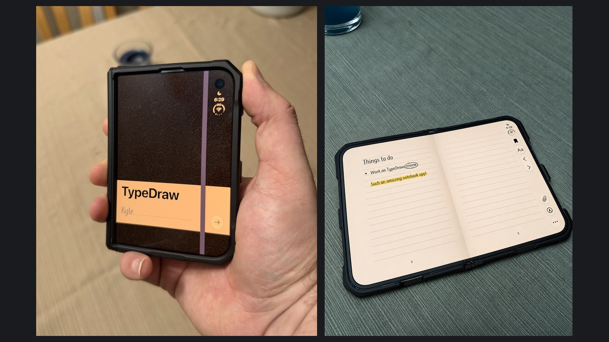

Of the things a folding phone can pretend to be, a notebook might be the most immediately satisfying. A cover on the outside, pages when it opens, and room for a sentence beside a sketch. TypeDraw understands why that is a good fit for the iPhone Duo.

This is the sort of app that brings back the fun of the early iPhone for me. The old beer apps made the device into a glass you could tip. TypeDraw uses a different physical action, opening the phone, to make the object on screen feel at home in the hardware. It is a small idea with a lot of personality.

I like that the notebook is allowed to be the point. Capturing an idea does not always need a database or a system to maintain. Sometimes the invitation of a blank page is enough.


I received a review code. This review focuses on the iPhone Duo design, with my own device photos and researched feature, pricing, and privacy details. Drawing performance, syncing, and PDF export fidelity have not been independently verified.


## My take

TypeDraw's strongest design choice is making the Duo's fold part of the notebook. The interface has a physical explanation: a cover belongs outside and a spread belongs inside. That gives the app a sense of place before I write anything.

The newer releases make the practical case stronger, too. Separate notebooks and PDF export give that inviting page somewhere to grow. I would still check how well retrieval, syncing, and exported pages fit my own notes before treating it as a long-term archive, but organization is no longer limited to a single book.

## Opening the phone is opening the notebook

TypeDraw's [listing and release history](https://apps.apple.com/us/app/typedraw/id6822194774) describe notebook covers, page curls, and two-page views on the Duo. The developer's artwork carries the same idea through the paper and elastic-band details.

What appeals to me is how little explanation that needs. A two-page spread belongs on a device that opens like a book. The cover gives the closed state a role, so closing the phone can feel like putting the notebook away instead of just hiding the same interface behind a smaller screen.

That kind of design can be dismissed as decoration, but the feeling of using an app matters. If an interface makes me want to capture a thought, the pleasure has a practical effect. It does not need to make every interaction faster to be worthwhile.

There is a balance to keep. A page-turning effect should not get between me and the sentence I want to write. I want the notebook character to provide continuity, with familiar places for the page and its controls as the layout changes. The idea is strongest when the physical illusion helps me stay oriented.

<figure>
  
  <figcaption>Closed cover on the left, open pages on the right. The page includes a reminder to work on this review, a circled word, and a highlighted sentence. Photos by Kyle Reddoch; app by Shaped Fonts. Full photos: <a href="/assets/images/app-reviews-2026-11-05/typedraw/closed-cover-full.jpg">cover</a> and <a href="/assets/images/app-reviews-2026-11-05/typedraw/open-pages-full.jpg">pages</a>.</figcaption>
</figure>

## The handwriting is a design choice

The [developer's description](https://apps.apple.com/us/app/typedraw/id6822194774) combines freely placed text and drawings with twelve handwriting typefaces and the option to create a font from your own handwriting. Version 1.8 also opens up the preinstalled iOS system fonts and expands language support. Paper and ink are customizable, with settings that can differ between books. That is an interesting middle ground: the efficiency of typed text with some of the visual character of a handwritten page.

I can see the value in that without pretending a font recreates every quality of handwriting. Typed letters remain repeatable shapes. What the idea offers is familiarity and ownership, rather than the exact movement of a pen.

For me, customization should help the page feel comfortable and readable. It should not become the work itself. I would settle on a legible combination early and see whether the notebook still feels inviting after the novelty of changing its appearance has passed.

## Smart Marks and a page ready for drawing

TypeDraw's [Smart Marks](https://x.com/SpatiallyMe/status/2116954930913087578) follow text as its layout changes. Underlines, circles, highlights, and strikethroughs can stay attached to the words, alongside movable images and text wrapping.

Responsive annotation addresses a real tension in a digital notebook. If I underline a sentence and then edit the paragraph above it, I want the emphasis to remain attached to the words. Otherwise the freedom to draw becomes a maintenance problem every time I revise something.

That is the feature I would spend time with before making a recommendation. An attractive page is easy to demonstrate. A page that stays coherent through revisions is more useful. I have not yet measured how TypeDraw handles those edits in practice.

Version 1.8's [Ready to Draw mode](https://apps.apple.com/us/app/typedraw/id6822194774) keeps drawing available without a separate mode switch. There is also an option to accept drawing only from Apple Pencil, useful when fingers should navigate rather than leave marks. These are small interaction choices, but they affect how naturally writing and sketching can share a page.

## Separate notebooks and a way to take pages with you

TypeDraw now supports [up to five notebooks](https://x.com/SpatiallyMe/status/2118039340177891797): the included book and four optional purchases. That makes room for work notes, personal writing, or a particular project without mixing everything into one sequence of pages. The shelf also carries the physical notebook idea into organization.

The [1.7 release added PDF export](https://apps.apple.com/us/app/typedraw/id6822194774) for one page or a whole notebook. Search and a table of contents provide routes back to existing notes, while 1.8 adds quicker book switching and settings for individual books. Those are useful foundations for a growing collection.

PDF export gives the pages a practical route out of the app. I would still try a notebook containing text, images, and annotations before relying on it for an archive. I have not independently checked export fidelity, and a PDF is not the same thing as an editable notebook in another app.

## Price and privacy

[TypeDraw](https://apps.apple.com/us/app/typedraw/id6822194774) costs $4.99 as a one-time purchase, including one notebook. The four additional notebooks cost $1.99 each; there is no subscription. It requires iOS or iPadOS 26.

Notes stay on the device, with [optional iCloud sync and book locking](https://apps.apple.com/us/app/typedraw/id6822194774). Those are practical choices for a personal notebook: decide whether it should follow you across devices and which books need a lock.

## Who I would recommend considering it

TypeDraw is worth considering if the notebook metaphor itself appeals to you and you want a personal place for mixed text and sketches. On the Duo, it is especially easy to understand the attraction. The device and the object it represents open in the same way. The modest upfront price makes the decision relatively straightforward, provided the current organization fits your needs.

If your notes are a long-term reference system, I would put structure, retrieval, and portability first. For personal writing and sketches, though, there is something appealing about a phone becoming a little notebook. TypeDraw is a good example of the direction I want to see more developers explore: useful software that remembers the device can also be fun.
